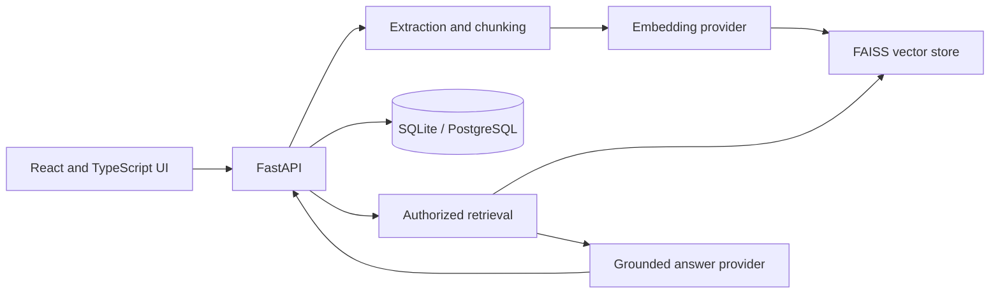

# KnowledgeOS — Private Knowledge Assistant

KnowledgeOS is an in-progress private document intelligence platform. Its goal is to answer questions from a user's own documents with inspectable evidence, and to say when the available evidence is insufficient.

This repository is being built in phases. **Phase 1 is implemented:** Python package foundations, validated settings and API data contracts, basic logging configuration, and unit tests. Document ingestion, retrieval, persistence, the API, and the frontend are not implemented yet; the instructions below do not imply that those features already work.

## Phase 0: repository assessment

The starting repository contained only this README. There was no application code, test suite, or project configuration. The initial working tree was clean.

## Phase 1: Python foundations

The `src/knowledgeos` package provides:

- Pydantic settings loaded from `KNOWLEDGEOS_` environment variables, with validated chunking and upload defaults.
- Pydantic contracts for search requests, document summaries, source references, and grounded answer responses.
- Standard-library logging setup with explicit validation of configured log levels.
- pytest coverage for configuration, schema validation, and logging behavior.

These schemas describe application boundaries; they do not yet provide endpoints, database persistence, authentication, or citation verification.

## Prerequisites and installation

Python 3.12–3.14 is supported. From the repository root:

```bash
python -m venv .venv
source .venv/bin/activate
python -m pip install -e ".[dev]"
```

Copy `.env.example` to `.env` to customize local settings. Settings are validated at startup when `get_settings()` is first called. Defaults include a 20 MiB upload limit, 1,000-character chunks, 150-character overlap, and five retrieval results. Chunk overlap must be smaller than chunk size. Chunking trades context against retrieval precision and index size; these initial values are configuration foundations, not yet used by an ingestion pipeline.

Run the current tests with:

```bash
python -m pytest
```

## Planned architecture



Only the Python foundations described above are implemented so far. The diagram is the intended design, not a claim that the components are already present.

## Development roadmap

1. Python foundations, schemas, configuration, logging, and tests (implemented).
2. PDF, TXT, and Markdown extraction, normalization, chunking, and metadata.
3. Replaceable embedding and vector-store interfaces with local FAISS search.
4. Evidence-grounded RAG answers, citation validation, and insufficient-evidence behavior.
5. FastAPI endpoints and persistent document and conversation storage.
6. Authentication and document access isolation.
7. React and TypeScript frontend.
8. Evaluation datasets and RAG quality tests.
9. Docker, CI, deployment configuration, and observability.
10. Complete operational, security, and contribution documentation.